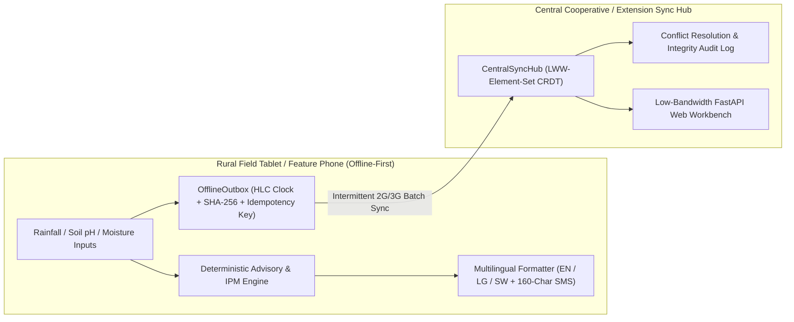

# AgriSignal — Offline-First Smallholder Agricultural Decision Support Platform

[](https://github.com/codesphere-u/agrisignal/actions/workflows/ci.yml)
[](LICENSE)
[](pyproject.toml)

**AgriSignal** is an open-source, offline-first agro-climatic decision support and field synchronization platform engineered for smallholder farmers, rural cooperatives, and agricultural extension officers across East Africa.

Unlike cloud-only agritech dashboards that fail when 2G/3G cellular coverage drops or black-box AI tools that issue unverified yield promises, **AgriSignal** combines:
1. **Explainable Rule-Based Crop & Planting Advisories** with explicit **Confidence & Uncertainty Bounds** (`confidence_interval`, `data_completeness_score`, `missing_sensor_warnings`, and deterministic `rule_trace` audit logs).
2. **Non-Chemical Integrated Pest Management (IPM) Early-Warning Matrix** for Fall Armyworm (*Spodoptera frugiperda*), Coffee Wilt / Coffee Berry Borer (*Hypothenemus hampei*), Cassava Mosaic / Brown Streak Virus (*Bemisia tabaci* vector), Bean Anthracnose, and Banana Bacterial Wilt (BXW).
3. **Offline-First Outbox & LWW-Element-Set Conflict-Free Sync Engine** powered by Hybrid Logical Clocks (`hlc_timestamp`), idempotency keys, and SHA-256 content hashes for deterministic reconciliation after days offline.
4. **Multilingual & Low-Literacy SMS Delivery** in **English (`en`)**, **Luganda (`lg`)**, and **Swahili (`sw`)**, including a strict `<= 160` character GSM-7 SMS advisory formatter.

---

## Architecture Overview



---

## Supported Crops & Agro-Ecological Zones

| Crop Key | Common & Scientific Name | Optimal 14d Rain (Baseline) | Optimal Soil pH | Key Monitored Pest / Disease Threats |
| :--- | :--- | :--- | :--- | :--- |
| `maize` | Maize (*Zea mays*) | 55 – 135 mm | 5.5 – 7.0 | Fall Armyworm (*Spodoptera frugiperda*), Post-harvest Aflatoxin |
| `robusta_coffee` | Robusta Coffee (*Coffea canephora*) | 65 – 150 mm | 5.0 – 6.5 | Coffee Berry Borer (*H. hampei*), Coffee Wilt Disease (*G. xylarioides*) |
| `beans` | Common Beans (*Phaseolus vulgaris*) | 45 – 110 mm | 5.8 – 7.0 | Bean Anthracnose (*Colletotrichum lindemuthianum*) |
| `cassava` | Cassava (*Manihot esculenta*) | 35 – 125 mm | 4.8 – 6.8 | Cassava Mosaic (CMD) & Brown Streak (CBSD) via *Bemisia tabaci* |
| `matooke_banana` | East African Highland Banana (*Musa acuminata*) | 60 – 145 mm | 5.5 – 7.0 | Banana Bacterial Wilt (BXW - *Xanthomonas campestris* pv. *musacearum*) |
| `groundnuts` | Groundnuts (*Arachis hypogaea*) | 40 – 105 mm | 5.3 – 6.7 | Aflatoxin harvest moisture risk, Foliar fungal spot |

**Supported Agro-Ecological Zones**:
- `lake_victoria_crescent` — Bimodal rainfall (Mar–May, Sep–Nov), Ferralsols / clay-loam (`evaporation_factor = 1.0`)
- `western_highlands` — Sub-humid montane volcanic soils (`evaporation_factor = 0.85`)
- `northern_savannah` — Unimodal / warm continental sandy-loams (`evaporation_factor = 1.25`)
- `eastern_plains` — Bimodal warm transitional plains (`evaporation_factor = 1.15`)

---

## Quickstart

### 1. Run an Explainable Crop Advisory (CLI)

```bash
uv run agrisignal advise \
  --crop maize \
  --zone lake_victoria_crescent \
  --stage planting \
  --rain-14d 85 \
  --soil-ph 6.2 \
  --lang lg
```

Sample output:
```text
==========================================================================
AGRISIGNAL EXPLAINABLE ADVISORY: Maize (Zea mays) [PLANTING] in Lake Victoria Crescent: OPTIMAL (PROCEED_STANDARD)
==========================================================================
Localized Summary (lg): [AgriSignal Oluganda] Ekirime: Kasooli (Okusiga) mu Lake Victoria Crescent | Enkuba ennaku 14: 85mm | Embeera: OPTIMAL. Amagezi: Embeera nnungi. Siga oba lima mu mabanga agalagirwa. (Obwesigwa bw'amawulire: 72% - gezesa ettaka lyo).
SMS 160-Char (118/160): AGRISIGNAL Kasooli(Okusiga): OPTIMAL. Rain14d:85mm. Embeera nnungi. Siga/lima mu budde. Conf:57-87% (No yield guarantee)
```

### 2. Simulate 20 Offline Field Records Across 3 Rural Tablets

```bash
uv run agrisignal simulate-sync
```

Demonstrates 20 field envelopes across `tablet-masaka-01`, `tablet-mbale-02`, and `tablet-gulu-03` with simulated network partitions, out-of-order sync delivery, duplicate 2G packet retries, tombstone deletions, and deterministic `LWW-Element-Set` conflict resolution.

### 3. Launch the Low-Bandwidth Web Workbench

```bash
uv run agrisignal serve --port 8099
```

Open `http://127.0.0.1:8099` to access the **AgriSignal Field & Extension Workbench**, or query the JSON API endpoints:
- `GET /api/health`
- `GET /api/metadata`
- `POST /api/advise`
- `POST /api/pest-risk`
- `POST /api/sync/simulate`
- `POST /api/sync/reconcile`

---

## Running Tests

```bash
uv run --with pytest --with fastapi --with httpx --with pydantic pytest -v
```

---

## Documentation Index

- [Architecture & Data Flow](docs/architecture.md)
- [ADR-001: Offline Outbox & Epistemic Uncertainty Reporting](docs/decisions/001-offline-outbox-and-uncertainty-reporting.md)
- [Testing & Verification Guide](docs/testing.md)
- [Known Limitations & Biosafety Boundaries](docs/limitations.md)
- [Security Policy](SECURITY.md)
- [Contributing Guidelines](CONTRIBUTING.md)

## License

Released under the [MIT License](LICENSE).
